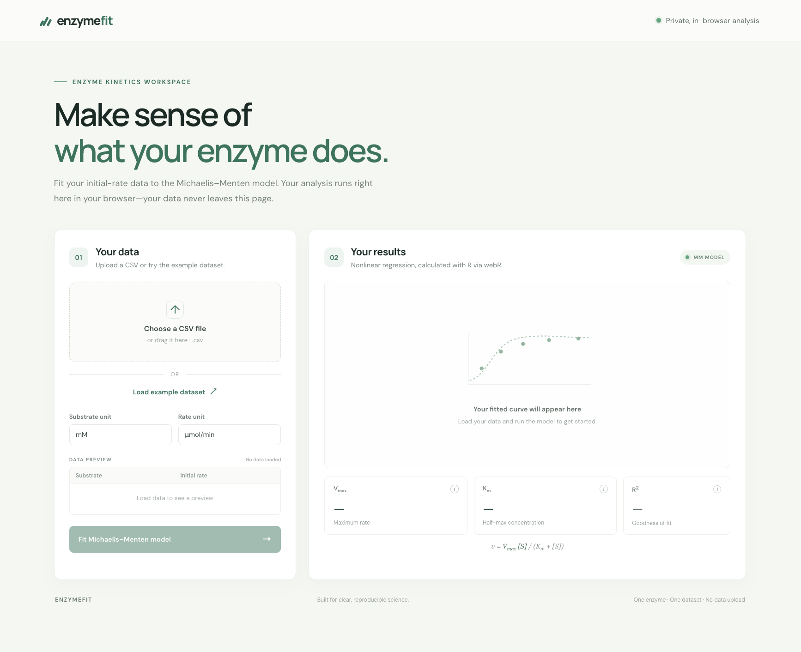
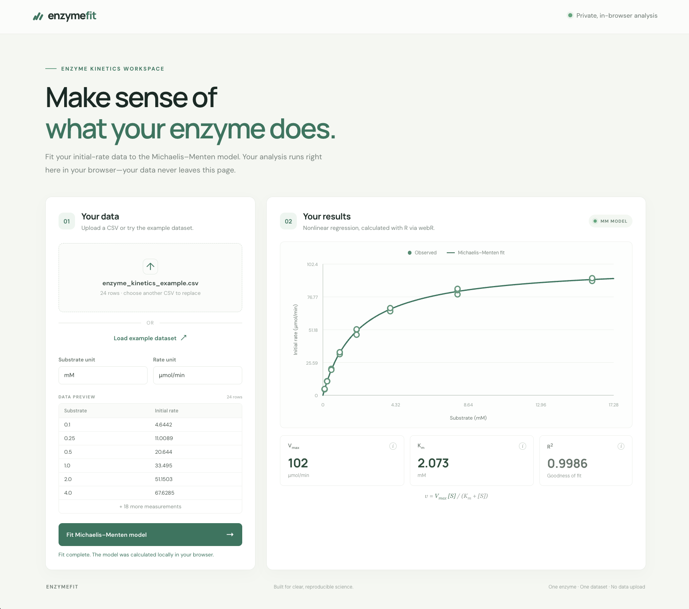

# enzymefit-kinetics# EnzymeFit

## App plan

- **Aim:** Estimate Vmax and Km from enzyme-kinetics data.
- **Input:** A CSV file containing substrate concentration and initial reaction rate.
- **Method:** Michaelis–Menten nonlinear regression using R through webR.
- **Output:** Parameter estimates with units and a graph showing the observations and fitted curve.
- **Research link:** Enzyme-kinetics analysis supports the investigation of enzymes and potential inhibitors in drug discovery.
- **Scope:** One enzyme and one dataset; no inhibitor comparison in the first version.
## Screenshots

### Start screen

### Successful results

